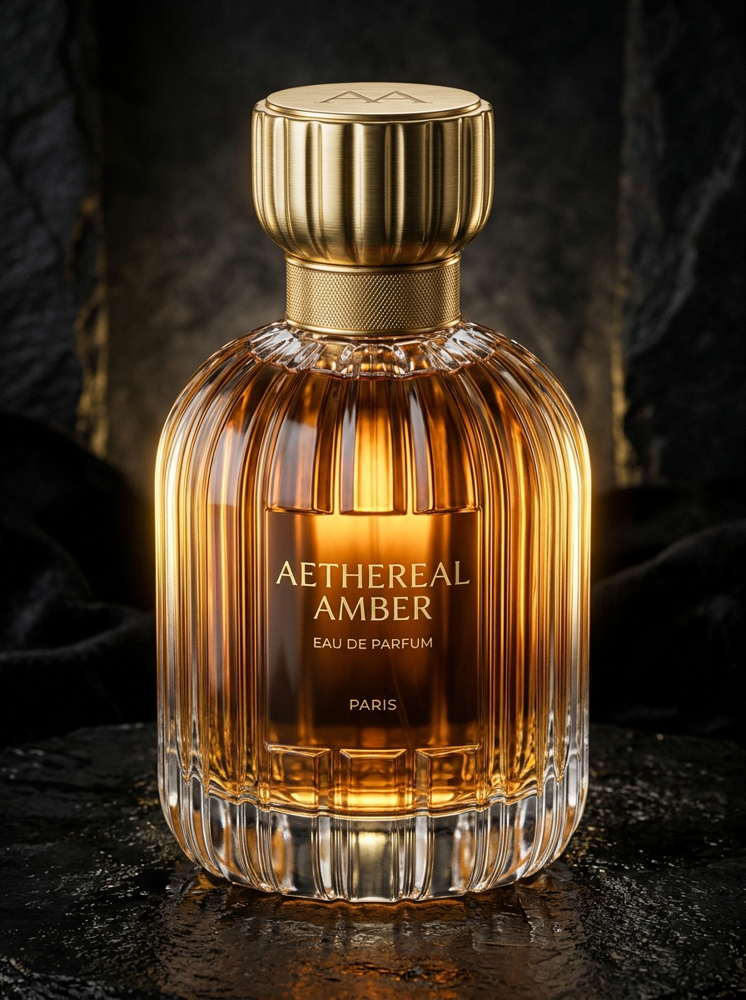
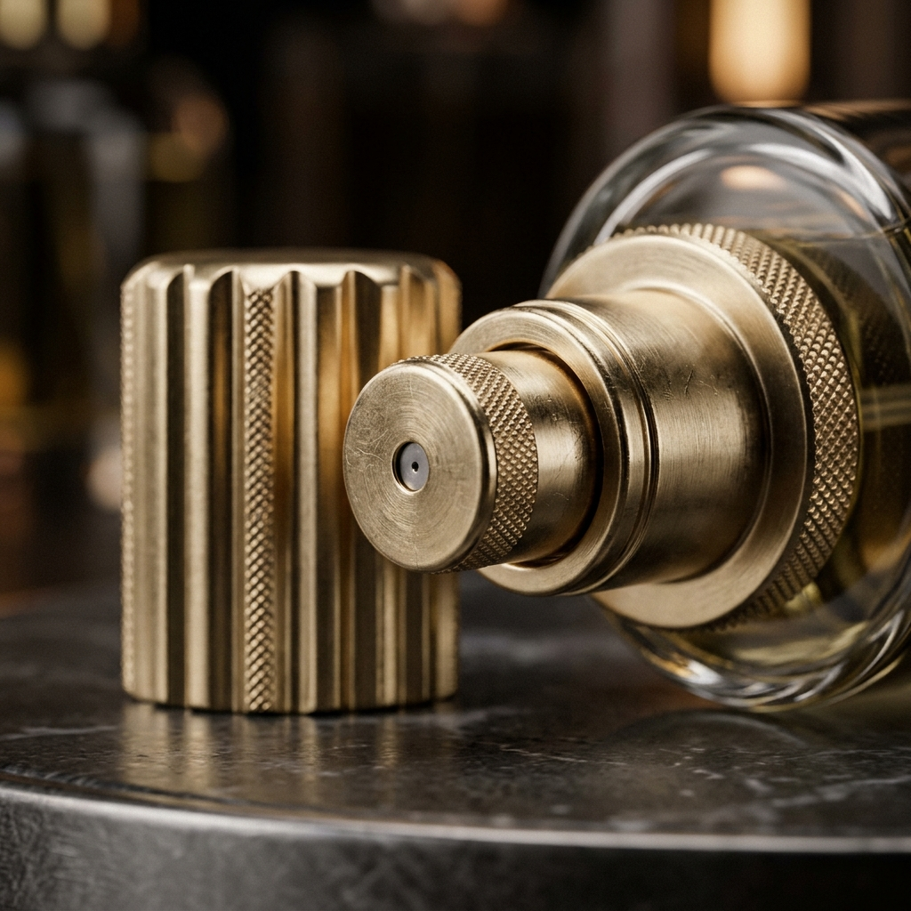
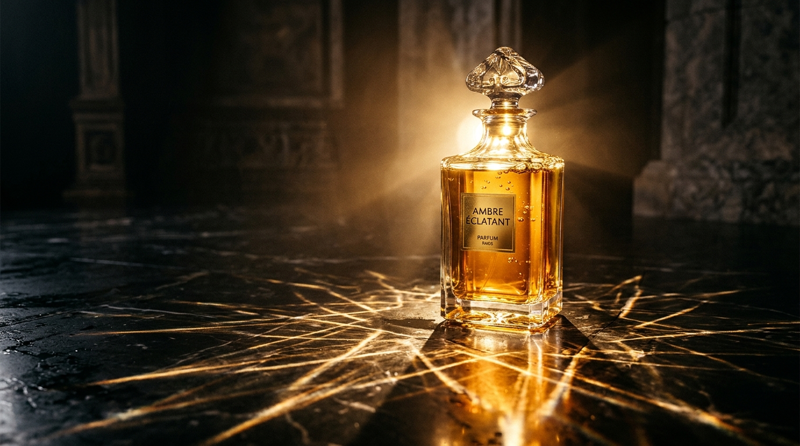
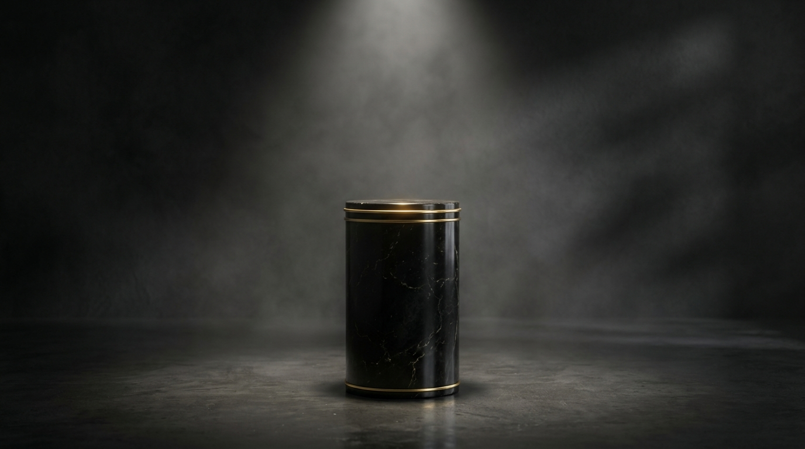
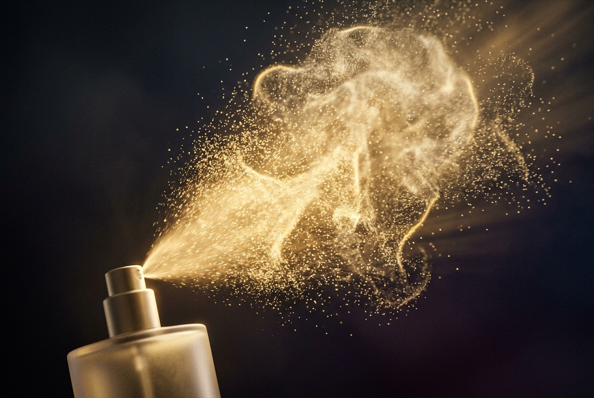
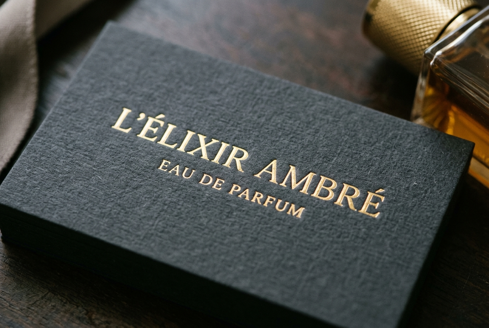

# FINAL PROJECT — 3D MOODBOARD & PRODUCTION BLUEPRINT

**Project Title:** L'ÉLIXIR AMBRÉ — 10s Luxury Perfume Commercial  
**Industry:** Cosmetics &bull; Luxury Fragrance  
**Target Engine:** Blender 4.x (Cycles Engine)  
**Format:** 10 Seconds &bull; 3 Cinematic Shots (24 FPS)

---

## 1. Project Concept & Creative Brief

> [!IMPORTANT]
> **Creative Logline:**  
> A high-end 10-second commercial showcasing an artisanal fluted glass perfume bottle filled with warm glowing amber fragrance. The piece emphasizes tactile micro-details—knurled brushed brass, refractive caustics, and volumetric golden mist—culminating in a dramatic reveal on a dark marble stage.

---

## 2. Visual Reference Carousel

````carousel

<!-- slide -->

<!-- slide -->

<!-- slide -->

<!-- slide -->

<!-- slide -->

````

---

## 3. Curated Color Palette

| Swatch Name | Hex Code | Purpose in 3D Scene |
| :--- | :--- | :--- |
| **Obsidian Slate** | `#0E0D11` | Background cyclorama, dark marble, shadow depth |
| **Amber Elixir** | `#D99B43` | Fragrance liquid transmission, caustics rays |
| **Brushed Champagne** | `#E7C584` | Metallic cap, brass knurling, gold foil typography |
| **Deep Cognac** | `#874B1A` | Glass volume absorption, shadow gradient inside bottle |
| **Prism Highlight** | `#FDFBF7` | Specular reflection highlights along curved glass edges |

---

## 4. Planned 3-Shot Storyboard

```mermaid
timeline
    title 10-Second Commercial Flow
    section Shot 1 : 0:00 - 0:03
        Macro Pan : 85mm Macro, f/2.4
                  : Knurled gold cap detail with moving rim light
    section Shot 2 : 0:03 - 0:07
        Mist & Caustics : 50mm Medium angle
                        : Nozzle spray burst + radiant amber floor caustics
    section Shot 3 : 0:07 - 0:10
        Hero Reveal : 35mm Dolly-out
                    : Full bottle on marble pedestal + Gold title fade-in
```

---

## 5. Blender Technical Execution Blueprint

> [!TIP]
> **Glass & Fluid Shading Trick:**  
> In Cycles, ensure the liquid mesh slightly intersects (`Alt + S`) the inner wall of the glass bottle by a fraction of a millimeter. Do not leave a 0mm air gap, otherwise Blender calculates an air boundary and creates black refractive rings.

* **Bottle Material:** Glass BSDF or Principled BSDF with Transmission `1.0`, Roughness `0.005`, IOR `1.50`.
* **Liquid Material:** Transmission `1.0`, Roughness `0.0`, IOR `1.33`. Add a Volume Absorption node into the Material Output Volume socket (`Color: Amber #D99B43`, `Density: 2.5`) for photorealistic depth.
* **Cap Material:** Metallic `1.0`, Roughness `0.20`, Anisotropic `0.4` for circular lathe highlights.
* **Cycles Render Settings:** GPU Compute &bull; Noise Threshold `0.01` &bull; Max Samples `256` with OpenImageDenoise &bull; Enable "Shadow Caustics" under Object Properties &rarr; Shading.

---

## 6. Submission Checklist Verification

- [x] Chosen an industry/topic: **Cosmetics / Luxury Fragrance**
- [x] Decided on general project idea: **10s 3D Perfume Commercial**
- [x] Sourced high-res 3D references across 6 core categories
- [x] Included references for style, color, lighting, modeling, and animation
- [x] Packaged into an organized moodboard presentation
- [x] Ready to share with instructor for class discussion

